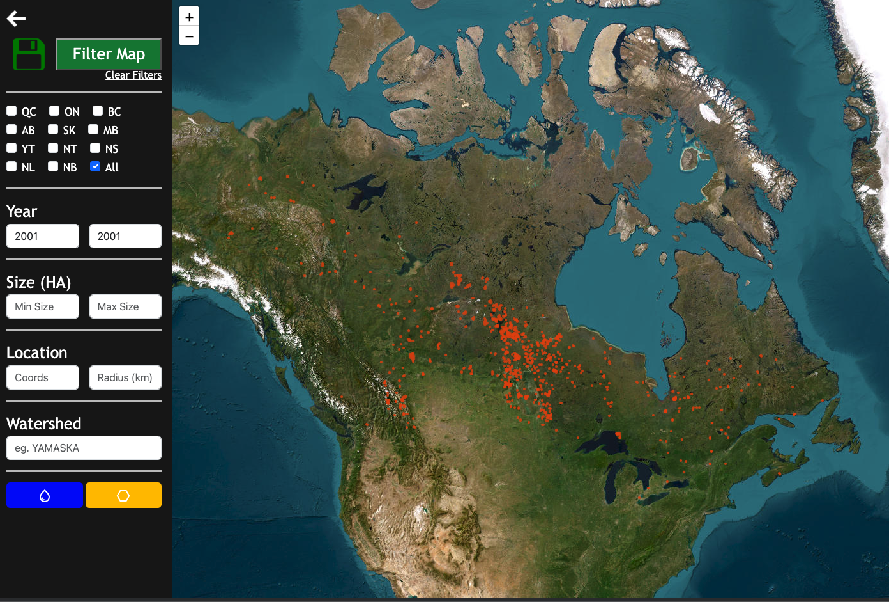
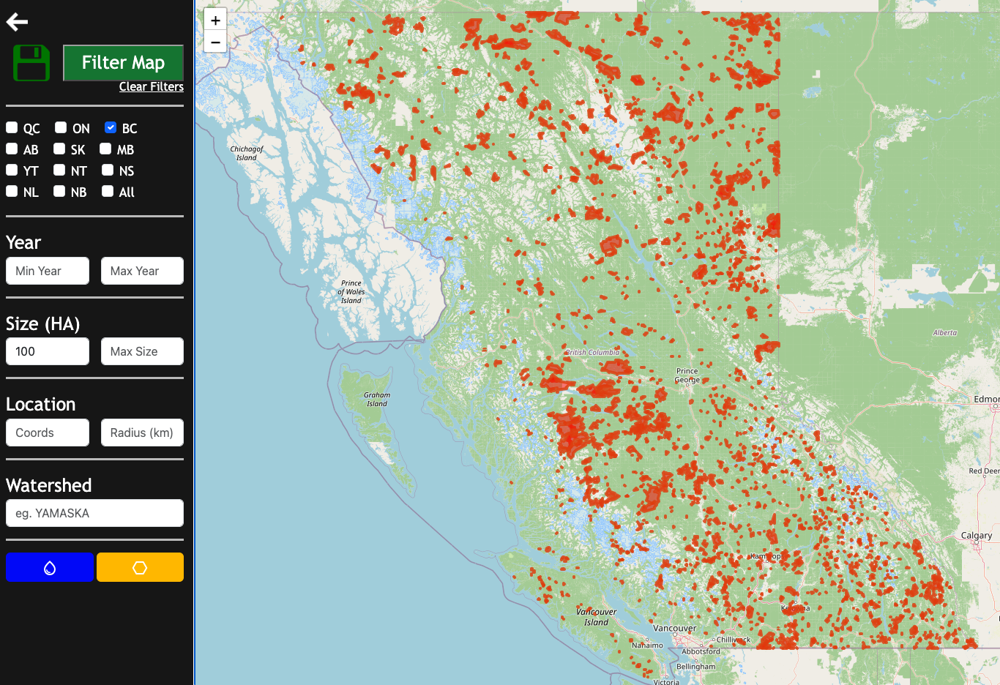
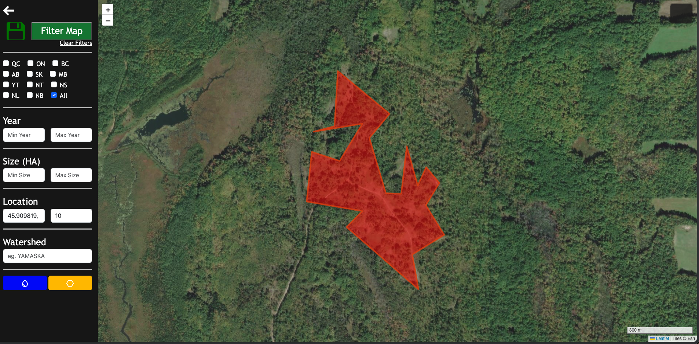
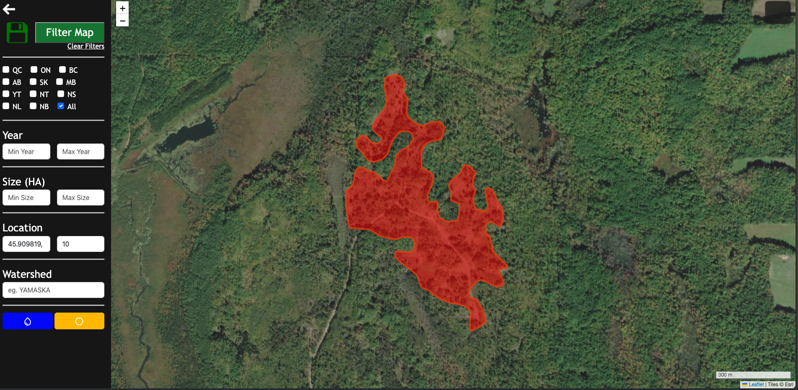
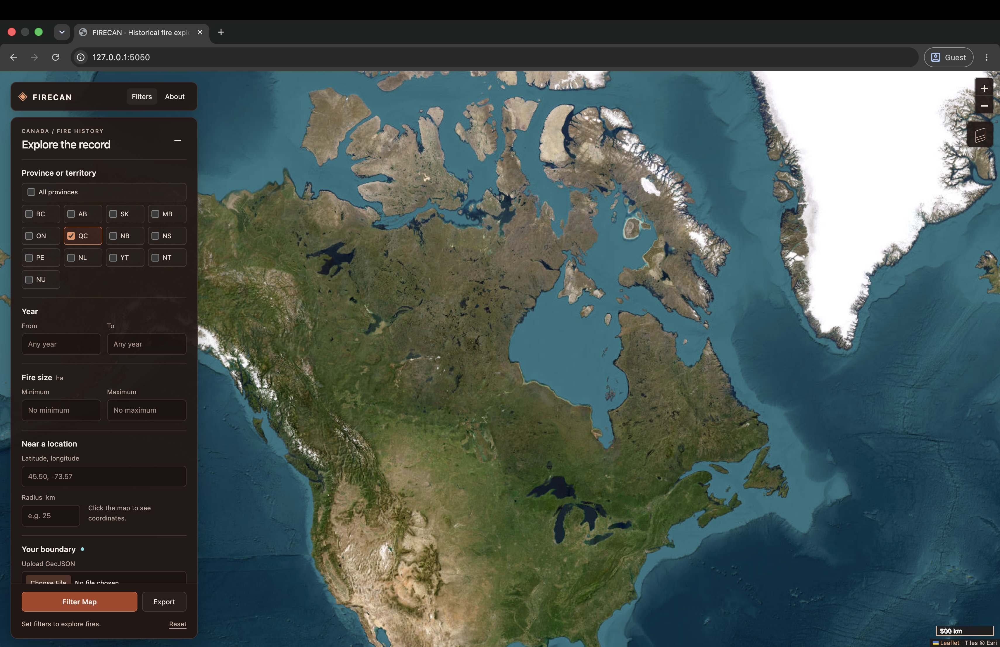
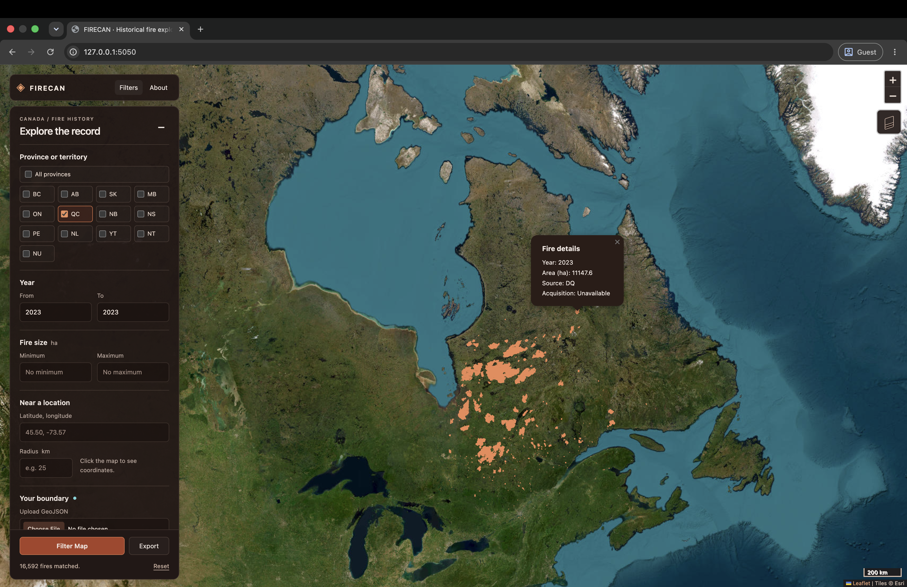
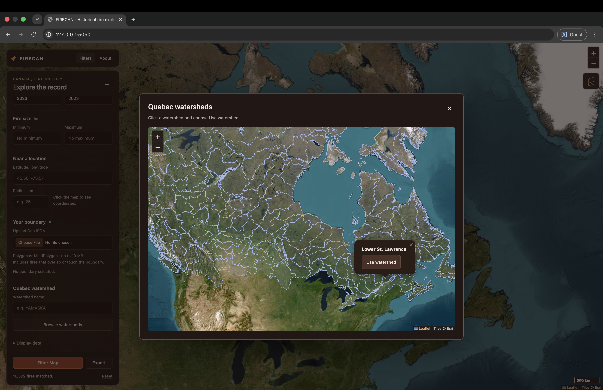

## Why FIRECAN? {.smaller}

:::: {.columns style="font-size: 0.9em;"}

::: {.column width="55%"}
**The problem**

- Canadian fire perimeters are public but scattered across agencies, formats and projections
- Quebec publishes its own data, split into pre- and post-1976
- CWFIS covers all of Canada but lacks very old fires
- Every clean subset ("fires > 500 ha within 50 km of X since 1990") means GIS wrangling - Barrier to information

**The goal**

- One merged dataset, one map, point-and-click filters, easy export
:::

::: {.column width="45%"}
**Data sources**

| Region | Source |
|---|---|
| Quebec | Données Québec – *Feux de forêt* |
| Rest of Canada | CWFIS – NFDB |
| Watersheds | Esri Canada |

Common schema: `fire_year`, `fire_size` (ha), `province`, `data_source`, `geometry` (EPSG:4326)
:::

::::

::: notes
Frame this as a tool for anyone in the lab who needs fire history as a covariate or study-area screen.
:::

## How it works

:::{style="font-size: 0.9em;"}
- **Backend:** Python · Flask · GeoPandas · Shapely (`app/firecan_main.py`, `app/firecan_fx.py`)
- **Frontend:** single-page HTML + Leaflet (`static/`)
- **Caching:** processed data stored as GeoParquet; first run pulls pre-built files from GitHub Releases (~2 GB), falling back to raw downloads
:::

### Logic flow

:::: {.columns style="font-size: 0.6em;"}

::: {.column width="50%"}
[**Data setup**]{style="font-size: 1.2em;"}

- Checks if data exists locally
- If not, downloads from GitHub or the raw source
- Data is processed and cached
:::

::: {.column width="50%"}
[**Request loop**]{style="font-size: 1.2em;"}

- User picks filters in the frontend
- Filters are applied to the data
- Results are sent back for display and export
:::

::::


::: notes
First run takes up to ~15 min, mostly download. After that, startup is fast because everything is read from parquet.
:::

## What you can do with it {.smaller}

::: columns
::: {.column width="50%"}
**Filters** (combined with AND)

- Province (one, several, or all)
- Year range (min / max)
- Fire size in hectares (min / max)
- Radius around a lat/lon point (buffered in a local UTM CRS, so km are real km)
- Within a selected watershed (via the Watershed Explorer)

**Performance knob**

- Polygon tolerance → `simplify()` geometries to trade detail for load time
:::

::: {.column width="50%"}
**Export filtered set**

- CSV
- GeoJSON
- GeoPackage

**Getting started**

```bash
git clone https://github.com/thomascheung05/FIRECAN
cd FIRECAN
./FIRECAN.sh   # builds venv, installs deps,
               # fetches data, opens browser
```

Runs locally at `http://127.0.0.1:5000`
:::
:::

::: notes
Good place for a quick live demo: e.g., all QC fires > 1000 ha since 2000 within one watershed, then export to GPKG.
:::

## Filtering All Of Canada
{width=100%}

## Filtering BC
{width=100%}

## Filtering Watershed
{width=100%}

## Filtering Watershed
{width=100%}

## Filtering Radius
{width=100%}

## Polygon Tolerance
{width=100%}

## Polygon Tolerance
{width=100%}

## Status, next steps & feedback {.smaller}

::: columns
::: {.column width="50%"}
**Current limitations**

- Datasets are large (efficiency)
- Runs locally only (no hosted instance yet)
- Limited Exposure
- Not tested in practical setting

**Planned**

- Onboarding Brad Henry
- Let users **upload their own polygon** (parks, study areas, tenure blocks…) and filter by it
- Update UI
- Get and apply feedback
:::

::: {.column width="50%"}
**Feedback**

- What features would be beneficial to your work
- How familiar are you with running python apps
- How useful would it be to host it online
- Keep it Canadian or expand 
- Other outputs (maps, summary tables)
- UI quick fixes 
:::
:::

## New UI
{width=100%}

## New UI
{width=100%}

## New UI
{width=100%}
